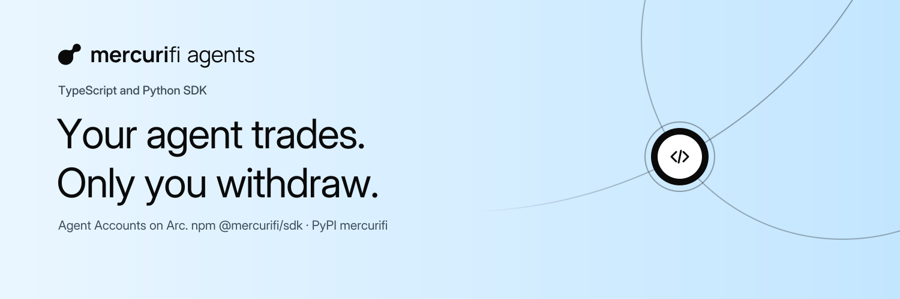

<p align="center">
  <picture>
    <source media="(prefers-color-scheme: dark)" srcset="assets/banner-dark.png">
    
  </picture>
</p>

<p align="center">
  
</p>

<h1 align="center">Mercurifi Agent Accounts · SDK</h1>

<p align="center">
  <a href="https://www.npmjs.com/package/@mercurifi/sdk"></a>
  <a href="https://pypi.org/project/mercurifi/"></a>
  <a href="#deployment"></a>
  <a href="docs/verify-provenance.md"></a>
  <a href="packages/typescript/package.json"></a>
  <a href="packages/python/pyproject.toml"></a>
  <a href="LICENSE"></a>
</p>

<p align="center">
  <a href="https://launch.mercuri.finance">launch.mercuri.finance</a> ·
  <a href="https://docs.mercuri.finance">docs.mercuri.finance</a> ·
  <a href="https://github.com/mercuri-finance/mercuri-agent-contracts">contracts</a>
</p>

TypeScript (npm `@mercurifi/sdk`) and Python (PyPI `mercurifi`) SDKs for Mercurifi Agent Accounts on Arc: an account
that holds USDC and Launch tokens, and agent keys that trade for it inside caps the owner sets. Your bot or AI agent
holds a key that can buy and sell on Mercurifi Launch bonding curves and graduated pools, launch tokens and claim
creator fees. It can never withdraw: only the owner can, and only to itself. Mercurifi never runs agents and never holds
an agent key.

**Contents** · [Install](#install) · [Deployment](#deployment) · [Quickstart](#quickstart-arc-testnet) ·
[Loss bound](#loss-bound) · [Owner and agent](#owner-and-agent) · [Examples](#examples) · [Units](#units) ·
[Chain-only or with the API](#chain-only-or-with-the-api) · [Errors](#errors) ·
[ERC-8004 identity](#erc-8004-identity-optional) · [Circle Wallets](#circle-wallets) ·
[Local development](#local-development) · [Verify a release](#verify-a-release) · [Security](#security) ·
[License](#license)

## Install

```sh
npm install @mercurifi/sdk      # TypeScript / JavaScript, Node 20 or newer
pip install --pre mercurifi     # Python 3.10 or newer
```

Both are beta releases (`0.1.0-beta.0` on npm, `0.1.0b0` on PyPI). `pip` needs `--pre` to pick a beta. Each package is
built and published by this repository's release workflows, with signed provenance; see
[Verify a release](#verify-a-release). Install only these two names: anything else is not ours
([docs/reserved-names.md](docs/reserved-names.md)).

## Deployment

**Testnet only.** Agent Accounts are deployed on Arc testnet, version 1.0.0-beta.1. Mainnet agent addresses stay empty
until an owner-approved deployment is recorded, and agent operations on mainnet throw `NotDeployedError`. A local
chain also works (chain 31337, loopback RPC, a local address book).

| Contract | Address (testnet, chain 5042002) | Mutability |
| --- | --- | --- |
| AgentAccountFactory | [`0x6D56A15c25782FF638943A4E81A1eD1ea862C9Bd`](https://explorer.testnet.arc.io/address/0x6D56A15c25782FF638943A4E81A1eD1ea862C9Bd) | immutable |
| AgentPolicyRegistry | [`0xcfCDA6a022314eA7Ae995cCf88e4eeB3A8802C69`](https://explorer.testnet.arc.io/address/0xcfCDA6a022314eA7Ae995cCf88e4eeB3A8802C69) | immutable |
| AgentAccount (implementation) | [`0xD11567fDfc9833E39E7EEbB0964c7bB7f4FF40b5`](https://explorer.testnet.arc.io/address/0xD11567fDfc9833E39E7EEbB0964c7bB7f4FF40b5) | immutable |

The SDK checks each address's runtime code hash against its address book before the first call, so a wrong RPC or a
look-alike contract fails before anything is signed. The source, the deployment record and the bytecode verification
are in [mercuri-agent-contracts](https://github.com/mercuri-finance/mercuri-agent-contracts#deployment). Testnet USDC
for gas and deposits: [faucet.circle.com](https://faucet.circle.com) (Arc testnet).

## Quickstart (Arc testnet)

The owner wallet creates an account with a fresh agent key, deposits USDC and gives the key a little gas; the agent key
then buys a Launch token.

```ts
import type { Address } from 'viem';
import { createClient, generateAgentKey, localKey } from '@mercurifi/sdk';

const mf = await createClient({ network: 'testnet' });
const owner = mf.owner(localKey(process.env.OWNER_KEY!));
const key = generateAgentKey(); // demo only: a real bot stores the key in a secret manager and reads it at the call site
const { account } = await owner.createAccount({ firstAgent: { address: key.address } });
await owner.deposit(account, { usdc: '20' });
await owner.fundGas(key.address, { usdc: '0.5' });
const agent = await mf.agent({ account, signer: localKey(key.exportPrivateKey()) });
const fill = await agent.buy({ token: process.argv[2] as Address, usdc: '5', slippage: 0.02 });
console.log(`bought ${fill.tokens} tokens for ${fill.usdcSpent} USDC in ${fill.txHash}`);
```

```python
import asyncio
import os
import sys

from mercurifi import FirstAgent, create_client, generate_agent_key, local_key


async def main() -> None:
    mf = await create_client("testnet")
    owner = mf.owner(local_key(os.environ["OWNER_KEY"]))
    key = generate_agent_key()  # demo only: a real bot stores the key in a secret manager and reads it at the call site
    created = await owner.create_account(first_agent=FirstAgent(key.address))
    await owner.deposit(created.account, usdc="20")
    await owner.fund_gas(key.address, usdc="0.5")
    agent = await mf.agent(created.account, local_key(key.export_private_key()))
    fill = await agent.buy(sys.argv[1], usdc="5", slippage=0.02)
    print(f"bought {fill.tokens} tokens for {fill.usdc_spent} USDC in {fill.tx_hash}")


asyncio.run(main())
```

The package READMEs go further: [TypeScript](packages/typescript/README.md) and
[Python](packages/python/README.md) (including the blocking `Client` for scripts and notebooks).

## Loss bound

A stolen agent key can still lose money through bad trades: buying an attacker's token, or selling the account's holdings into a price the attacker pushed down. **That loss is bounded by the account's caps, not prevented.** Per period, the bound is the USDC spend cap plus the sell cap, which is measured at the account's own cost basis. It keeps accruing every period until the key is revoked or expires.

Read [docs/security-model.md](docs/security-model.md) before you give a key to a program.

## Owner and agent

The owner (main wallet) creates the account, deposits and sets policy; an agent key trades inside the policy. Owner
settings are on the policy registry and funds are on the account:

| | |
| --- | --- |
| `AgentAccount` | Holds the funds and the cost basis, and is the only contract an agent key calls. |
| `AgentPolicyRegistry` | The owner's settings, the queue, the pause and the usage counters; one per factory, immutable, no admin and no owner of its own. Each owner call names the account. |
| `AgentAccountFactory` | Creates accounts and sets the beta ceilings. |

Sells count against the sell cap at the higher of the position's current average cost and its high-water average cost,
so a stolen key cannot buy a crashed token cheaply to stretch the sell cap for tokens the account bought. Holdings
received from outside (airdrops, transfers in) are valued by a quote an attacker can move; they are not protected by
the sell cap — withdraw them.

Full detail, including who else holds power (the guardian pause, the Launch timelock), is in
[docs/security-model.md](docs/security-model.md#where-things-live).

## Examples

| TypeScript | Python | What it does |
| --- | --- | --- |
| [`quickstart-testnet.ts`](packages/typescript/examples/quickstart-testnet.ts) | [`quickstart_testnet.py`](packages/python/examples/quickstart_testnet.py) | The quickstart above, as a runnable file. |
| [`market-maker.ts`](packages/typescript/examples/market-maker.ts) | [`market_maker.py`](packages/python/examples/market_maker.py) | Buys and sells one token inside the caps (selling needs the opt-in sell permission). |
| [`launch-bot.ts`](packages/typescript/examples/launch-bot.ts) | [`launch_bot.py`](packages/python/examples/launch_bot.py) | Launches a token from the account, with an optional image upload through the API. |
| [`llm-tools.ts`](packages/typescript/examples/llm-tools.ts) | [`llm_tools.py`](packages/python/examples/llm_tools.py) | Tool definitions for a model: one JSON call in, one JSON result out, numbers only. |

Each file's header gives the command line and the environment it reads. Token names and descriptions are written by
whoever launched the token: never hand them to a model as instructions.

## Units

Amounts are human strings in `usdc` / `amount` (`usdc: '25'`, `amount: '1000.5'`). Base units go only in the separately
named fields `usdc6` and `amountWei` (`bigint`). A JavaScript `number` in a human field is rejected, never guessed. The
Python SDK also accepts `Decimal`, takes `usdc6` and `amount_wei` as `int`, and rejects an `int` or `float` in a human
field.

## Chain-only or with the API

Every on-chain action works with only an RPC URL. Add an API key (`X-Api-Key`, `mfk_live_…` / `mfk_test_…`) for
streams, metadata uploads and the account index. A key sets a rate tier, attribution and route scopes (read, stream,
build, upload); it never authorises funds. Uploads need the key owner's agent account to be older than 24 hours.

## Errors

Every error carries a stable `code` and a readable message. A call the account would refuse fails before anything is
sent, as a `ContractRevertError` that names the revert. Branch on `code` and `revert.name`, never on message text, and
never hand a message to a model.

## ERC-8004 identity (optional)

Both SDKs can build an [ERC-8004](https://eips.ethereum.org/EIPS/eip-8004) registration file that lists an agent
account, plus the calldata to register it on Arc testnet. The owner wallet (an EOA) signs and sends it. The agent
account cannot register itself, and it cannot sign (`isValidSignature` always fails), so it is never the registry's
verified `agentWallet`. It appears only as a service entry in the file. See "ERC-8004 identity (optional)" in either
package README.

## Circle Wallets

A Circle wallet, including a Circle Agent Wallet (a smart-contract account), can be an account's owner, because owner
checks are `msg.sender`-based. It cannot be the agent key of a self-hosted agent, because it has no exportable key and
signs through Circle's API. No adapter is provided.

## Local development

- Prerequisites for the Anvil tier: Foundry's `anvil` and `forge` on the PATH, and a checkout of the agent contracts
  (`git clone --recurse-submodules https://github.com/mercuri-finance/mercuri-agent-contracts.git`). Point
  `MERCURIFI_CONTRACTS_DIR` at it (for example `export MERCURIFI_CONTRACTS_DIR=$HOME/src/agent-contracts`);
  `scripts/local-chain.sh` and `scripts/gen-abis.mjs` (except `--verify-digest`) stop with a clear message when it is
  unset.
- `scripts/local-chain.sh` starts a loopback Anvil (chain 31337) on `127.0.0.1:$ANVIL_PORT` (default 8545), deploys the
  Launch and agent contracts, and writes `fixtures/local-book-<port>.json`. `scripts/stop-local-chain.sh [port]` stops
  it.
- The test tiers find the chain from the same `ANVIL_PORT`. `ANVIL_RPC` may override the URL; its port then names the
  book, so keep the two consistent.
- `cd packages/typescript && npm test && npm run typecheck`; `npm run test:integration` runs the Anvil tier
  (`RECORD=1` rewrites `fixtures/recorded`).
- `cd packages/python && uv run pytest`; `uv run pytest -m integration` runs the Anvil tier.
- `MERCURIFI_LIVE_TESTNET=1` opts in to the read-only live tests against Arc testnet.

Nothing here broadcasts to a real network.

## Verify a release

Every published version is built from `main` by [`release-npm.yml`](.github/workflows/release-npm.yml) or
[`release-pypi.yml`](.github/workflows/release-pypi.yml), after the maintainer approves the release environment. No
long-lived registry token exists: npm and PyPI accept the upload only from those workflows (trusted publishing), and
each file carries signed provenance that names this repository, the workflow and the commit. On npm the workflow only
stages the version; it goes public after a second approval with the maintainer's 2FA.

```sh
npm audit signatures                      # in a project that depends on @mercurifi/sdk
npm view @mercurifi/sdk@0.1.0-beta.0 dist.attestations
```

On PyPI, each file's Provenance panel must name this repository and `release-pypi.yml`. The full steps are in
[docs/verify-provenance.md](docs/verify-provenance.md), and how a release is cut in [docs/releasing.md](docs/releasing.md).

## Security

| | |
| --- | --- |
| [`docs/security-model.md`](docs/security-model.md) | What an agent key can and cannot do, the loss bound, where each power lives, key handling, RPC and API key redaction. |
| Keys | Agent keys and API keys stay in your process: the SDK never sends a key anywhere, never logs it, and shows only the host of an RPC URL in errors. |
| Contracts | Immutable, no admin over accounts or funds; reviewed with AI assistance, not yet audited by a security firm. See the [contracts repository](https://github.com/mercuri-finance/mercuri-agent-contracts#security). |
| Reporting | Privately, through **Security → Report a vulnerability** on this repository. See [`SECURITY.md`](SECURITY.md). |

## License

[MIT](LICENSE).

---

<sub>Mercurifi and Mercurifi Agent Accounts are independent products. They are not affiliated with, sponsored by or
endorsed by Circle Internet Group, Inc. or its affiliates. Arc and USDC are trademarks of Circle Internet Group, Inc.
and/or its affiliates, named here only to say which network and which asset the SDK works with. Uniswap is a trademark
of Uniswap Labs.</sub>
